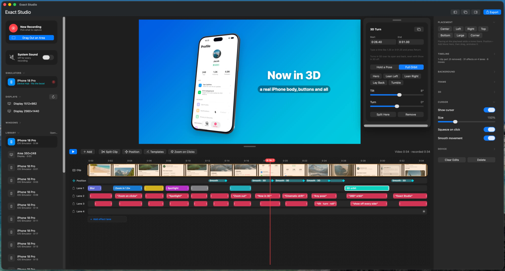

# Exact Studio

A macOS screen recorder built with [Exact](https://github.com/expo/exact). It records, edits and exports polished screen videos.



## Install

There is no download yet. You build the app on your Mac, which takes a few commands.

You need:

- A Mac with Apple silicon and macOS 14 or later.
- Xcode 27. The build works with Xcode 27.2 and fails with Xcode 26.6.
- [Bun](https://bun.sh).

Clone this repository and [expo/exact](https://github.com/expo/exact) into the same folder, then build and open the app:

```sh
git clone https://github.com/entiendoNull/exact-studio.git
git clone https://github.com/expo/exact.git
cd exact-studio
bun ../exact/scripts/exact.mjs setup    # once: installs Rust and the other tools that Exact pins
bun exact.mjs mac --run                 # builds the app and opens it
```

The first build takes several minutes. The first recording asks for Screen Recording permission. Allow it in System Settings › Privacy & Security, then reopen the app.

To update, run `git pull` in both folders and run the last command again.

## Features

### Record

- **Sources:** drag out an area, pick a window on screen, or choose a display, a window, or a Simulator or emulator from the sidebar.
- **Devices:** cropped to the bezel automatically.
- **Windows:** keep their own shape, rounded corners included.
- **System sound:** on by default, with one switch to turn it off.

### Look

- **Background:** 24 gradients, a custom gradient, or a blur of the recording.
- **Frame:** padding, rounded corners, a shadow, and an output shape (16:9, 9:16, 1:1, 4:3).
- **Cursor:** drawn from the recorded path, so you can hide, resize or smooth it.

### Motion and 3D

- **Placement:** drag the video in the preview, or use a preset.
- **Moves:** animate it to a new place, in one of eight styles.
- **3D:** a real 3D body made from the device's outline, side buttons included. Tilt it, turn it, or pick a pose.
- **Patterns:** ready-made moves such as side to side, turntable and orbit.

### Edit

- **Crop:** drag the corners or edges of a grid over the whole recording.
- **Timeline:** split the clip (S), remove parts, and crossfade between them.
- **Effects:** zoom, speed, spotlight, cursor highlight, blur, and black and white, on as many lanes as you need. A blur or black and white can cover the video, the whole frame, or everything.
- **Text:** styled texts with entrance, exit and loop animations.
- **Images:** put a logo, a badge or any picture on the video. Each image has its own moves and its own effects.
- **Rows by kind:** effects for the video, texts, images, sounds, and effects for the whole frame each have their own rows. Each row has a + that adds its own kind of thing at the playhead.
- **A tidy timeline:** every group folds away, and the rows have three heights to pick from.
- **Templates:** Launch, Hero, Tour and Teaser. Each adds texts, effects and moves for the frame's shape.
- **Zoom on clicks:** adds a zoom around each group of clicks.
- **Sound follows the cuts:** the recorded sound has its own row under the clip, with its waveform. Cuts, speed and fades apply to it too. Mute it or set its volume.
- **Music and sounds:** add music or a sound effect from a file, on sound lanes of their own. Each plays straight through from where it starts, whatever the cuts do, with its own volume and fades. Drop a sound file on the preview to add it at the playhead.

### Export and library

- **Export:** pick a quality (best, 1080p, 720p or small). Save to Movies or a place you choose, or copy to the clipboard.
- **Library:** every recording stays in the sidebar. File ▸ Open Recording… (⌘O) adds one from anywhere.

<details>
<summary>Keyboard</summary>

| Key | Action |
|---|---|
| Space | Play or pause |
| S | Split the clip at the playhead |
| Delete | Remove the selection |
| ← → | Step one frame (with Shift: one second) |
| ⌥-drag | Turn the video in 3D |
| ⌘O | Open a recording |
| Return / Escape | Start or cancel an area recording |

</details>

## For agents

Every recording's edit is plain JSON beside it: `edits.json` (cuts, transitions, effects, texts, images, sounds, zooms, speed, moves, 3D) and `look.json` (background, shape, padding, cursor). Edit them directly; the app reloads them within a second. `./exact-studio` checks and renders with the app's own renderer:

```sh
./exact-studio list
./exact-studio show latest
./exact-studio validate latest
./exact-studio frame latest 4.5     # .exact/frame.png
./exact-studio export latest
./exact-studio template latest hero
./exact-studio image latest logo.png --at 2 --for 6
./exact-studio sound latest music.m4a --at 0
```

[`docs/edits.md`](docs/edits.md) documents every field; [`schema/`](schema) has the JSON Schemas; the `edit-recording` skill (`.claude/skills/`) is the workflow.

### MCP

`mcp/server.ts` gives the same verbs to any MCP client: `list_recordings`, `show_recording`, `read_edits`, `write_edits`, `write_look`, `add_image`, `add_sound`, `validate_recording`, `render_frame` (returns the image), `export_video`, `apply_template` and `edit_format`. A write is checked first, and a failed check leaves the file as it was. Claude Code picks it up from `.mcp.json` in this folder. Elsewhere:

```sh
claude mcp add exact-studio -- bun /path/to/exact-studio/mcp/server.ts
```

## Run

```sh
bun exact.mjs mac --run
```

The app uses the Exact checkout at `../exact`. [Install](#install) has the full steps. While recording, a **Stop** item sits in the menu bar.

## Layout

- `app.contract`: the view. `app.ts`: forwards each request to the native module.
- `modules/apple/Capture.swift`: source listing, the area picker, the ScreenCaptureKit recorder, cursor and click tracking.
- `modules/apple/Bezel.swift`: finds the device in a captured window.
- `modules/apple/Compositor.swift`: the look, zooms and effects rendered per frame, and the time map across cuts and speed. The preview and the export share it.
- `modules/apple/Editor.swift`: one open recording: its edits, its player, the selection.
- `modules/apple/Timeline.swift`: the timeline view.
- `modules/apple/Templates.swift`: the ready-made edits.
- `modules/apple/Images.swift`: pictures on the video: their files, moves, effects and drawing.
- `modules/apple/Sounds.swift`: sounds over the video: their files, and the waveforms the timeline draws.
- `modules/apple/Scene3D.swift`: the 3D stage: the slab, its materials, lights and camera.
- `cli/main.swift`, `exact-studio`: the command-line tool.
- `mcp/server.ts`, `.mcp.json`: the MCP server around it.
- `modules/apple/Studio.swift`: the module's ops, the menu bar item, the preview view, export.
- `llp/`: the decisions behind the design, as short notes. Start at `llp/0000-exact-studio.explainer.md`. `./ref-check` checks them.

Recordings are kept in `~/Movies/Exact Studio/Recordings/<id>/` as `capture.mov` (HEVC with alpha, and AAC sound when recorded), `meta.json`, `cursor.json`, `edits.json`, `look.json` and, for a device, `mask-*.png`.

## Contributing

Changes reach `main` through pull requests. [CONTRIBUTING.md](CONTRIBUTING.md) has the setup, the checks and the steps.

## License

[MIT](LICENSE)
