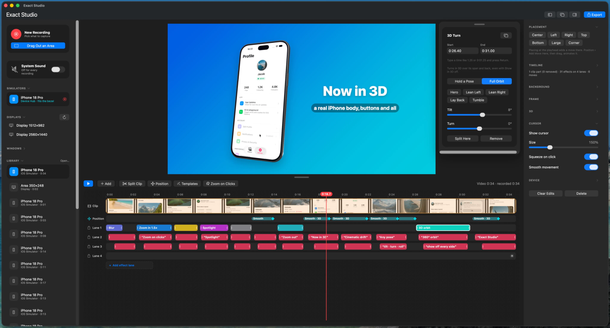

# Exact Studio

A macOS screen recorder and video editor built with [Exact](https://github.com/expo/exact), made so that **agents can edit your videos as well as you can**.

Every edit you can make in the app, an agent can make too: through a command-line tool, through an MCP server, or by changing two plain JSON files. An agent can also record on its own: it lists what can be recorded, starts, drives the app it records, and stops. Nothing about an edit lives only in the app. Cut, add texts, images and sounds, zoom, move, turn it in 3D, change the look, render a frame to check it, export: all of it works without the window. The app shows an agent's change within a second, so you can work on the same video together.

See [For agents](#for-agents) for the tools.



## Install

There is no download yet. You build the app on your Mac, which takes a few commands.

You need:

- A Mac with Apple silicon and macOS 14 or later.
- Xcode 27. The build works with Xcode 27.2 and fails with Xcode 26.6.
- [Bun](https://bun.sh).

Clone this repository and [expo/exact](https://github.com/expo/exact) into the same folder, then build and open the app:

```sh
git clone https://github.com/entiendoNull/exact-studio.git
git clone https://github.com/expo/exact.git
cd exact-studio
bun ../exact/scripts/exact.mjs setup    # once: installs Rust and the other tools that Exact pins
bun exact.mjs mac --run                 # builds the app and opens it
```

The first build takes several minutes. The first recording asks for Screen Recording permission. Allow it in System Settings › Privacy & Security, then reopen the app.

To update, run `git pull` in both folders and run the last command again.

## Features

### Record

- **Sources:** a display, a window, an area or a Simulator. Each is picked on the screen, and only the Start Recording button (or Return) starts it. A named Simulator or emulator in the sidebar records with one click.
- **Devices:** cropped to the bezel automatically.
- **Windows:** keep their own shape, rounded corners included.
- **System sound:** on by default, with one switch to turn it off.
- **Menu bar:** an Exact Studio mark is always there. Its menu starts each picker. While recording, it turns red with the time, and one click stops.
- **Agents record too:** an agent names a display, a window, an area or a Simulator, and the recording starts at once, with no picker. It shows in the menu bar like any other, and it never stops or replaces a recording that is running. See [Recording](#recording).

### Look

- **Background:** 24 gradients, a custom gradient, or a blur of the recording.
- **Frame:** padding, rounded corners, a shadow, and an output shape (16:9, 9:16, 1:1, 4:3).
- **Cursor:** drawn from the recorded path, so you can hide, resize or smooth it.

### Motion and 3D

- **Placement:** drag the video in the preview, or use a preset.
- **Moves:** animate it to a new place, in one of eight styles.
- **3D:** a real 3D body made from the device's outline, side buttons included. Tilt it, turn it, or pick a pose.
- **Patterns:** ready-made moves such as side to side, turntable and orbit.

### Edit

- **Crop:** drag the corners or edges of a grid over the whole recording.
- **Timeline:** split the clip (S), remove parts, and crossfade between them.
- **Effects:** zoom, speed, spotlight, cursor highlight, blur, and black and white, on as many lanes as you need. A blur or black and white can cover the video, the whole frame, or everything.
- **Text:** styled texts with entrance, exit and loop animations.
- **Masks:** hide an API key, an email or a name with a blur, big pixels or a solid box. A mask is placed on the full recorded frame (before the crop), so it stays on that part of the recording when the crop changes or the video zooms, moves or turns in 3D. It never fades.
- **Images:** put a logo, a badge or any picture on the video. Each image has its own moves and its own effects.
- **A timeline that grows with the edit:** a new recording shows the Clip alone. + Add puts a text, an image, a zoom, an effect, a move or music at the playhead, and a row appears for it; an empty row goes away. A second row of a kind appears only while two of its items overlap.
- **Rows as layers:** the text and image rows are the stack, front to back, with the Video among them. Drag a row by its label to put it in front or behind, the video too.
- **A tidy timeline:** the Video folds its Moves and Effects rows away, and the rows have three heights to pick from.
- **Zoom the timeline:** with the mouse wheel, a pinch, or the − and + buttons; Fit shows it all again. A trackpad scrolls instead, and a switch turns wheel zoom off.
- **Templates:** Clean Demo, Hero Angle, Before / After, Feature Spotlight, Social Hook, Tutorial Steps and Product Launch. Each fits the recording's length, clicks and frame shape. A template never writes a claim: its lines are [bracketed] placeholders, and export refuses them until you write them.
- **Zoom on clicks:** adds a zoom around each group of clicks.
- **Sound follows the cuts:** the recorded sound has its own row under the clip, with its waveform. Cuts, speed and fades apply to it too. Mute it or set its volume.
- **Music and sounds:** add music or a sound effect from a file, on sound lanes of their own. Each plays straight through from where it starts, whatever the cuts do, with its own volume and fades. Drop a sound file on the preview to add it at the playhead.

### Export and library

- **Export:** pick a quality (best, 1080p, 720p or small). Save to Movies or a place you choose, or copy to the clipboard.
- **Library:** every recording stays in the sidebar. File ▸ Open Recording… (⌘O) adds one from anywhere.

<details>
<summary>Keyboard</summary>

| Key | Action |
|---|---|
| Space | Play or pause |
| S | Split the clip at the playhead |
| Delete | Remove the selection |
| ← → | Step one frame (with Shift: one second) |
| ⌥-drag | Turn the video in 3D |
| ⌘O | Open a recording |
| Return / Escape | Start or cancel a recording in a picker |

</details>

## For agents

This is what the app is built around: the app, the command-line tool and the MCP server are three ways into the same edit, and they draw with the same renderer. When a feature is added to the app, it is added to all three, with the format guide and the editing skill.

Every recording's edit is plain JSON beside it: `edits.json` (cuts, transitions, effects, masks, texts, images, sounds, zooms, speed, moves, 3D) and `look.json` (background, shape, padding, cursor). Edit them directly; the app reloads them within a second. `./exact-studio` checks and renders with the app's own renderer:

```sh
./exact-studio list
./exact-studio show latest
./exact-studio validate latest
./exact-studio frame latest 4.5     # .exact/frame.png
./exact-studio export latest
./exact-studio template latest spotlight
./exact-studio image latest logo.png --at 2 --for 6
./exact-studio sound latest music.m4a --at 0
./exact-studio frame latest 4.5 --raw    # the full recorded frame, to measure a mask on
./exact-studio mask latest --rect 0.1,0.2,0.3,0.05 --at 2 --for 6
```

[`docs/edits.md`](docs/edits.md) documents every field; [`schema/`](schema) has the JSON Schemas; the skills in `.claude/skills/` guide an agent:

- `edit-recording`: the workflow and mechanics of recording and editing.
- `direct-recording`: the craft of making a recording into a promo, demo or ad: the key points, the copy, the pacing, the review.
- `send-feedback`: what to do when Exact Studio gets in the way: note it, ask, then open an issue or a pull request here.

Claude Code in this folder loads them by itself; through MCP, `edit_format`, `directing_guide` and `feedback_guide` return the same guidance.

### Recording

An agent records through the app, so the app's Screen Recording permission and its red menu bar mark apply. If the app is not running, `sources` and `record start` open it.

```sh
./exact-studio sources                                   # what can be recorded, with the names start takes
./exact-studio record start "simulator:iPhone 17 Pro" --max 120
./exact-studio record status
./exact-studio record stop                               # prints the new recording's id and folder
./exact-studio show latest
```

- A source is a name from `sources` (`display:1`, `window:Safari — GitHub`, `simulator:iPhone 17 Pro`), a unique part of one, or `area:x,y,w,h@<display>` in points.
- `--sound on|off` overrides the System Sound setting for this recording. `--max <seconds>` stops it by itself.
- A start is refused when a recording is running, when the name matches nothing or more than one source (the candidates are listed), or without the permission.
- `record stop` stops only a recording an agent started. `--any` also stops one a person started.
- Exit codes: 1 refused, 2 usage, 3 a person must act (the permission), 4 the app did not answer.
- Everything on the source is recorded. Prefer a Simulator or one window over a display, and hide secrets with a mask.

### MCP

`mcp/server.ts` gives the same verbs to any MCP client: `list_sources`, `start_recording`, `recording_status`, `stop_recording`, `list_recordings`, `show_recording`, `read_edits`, `write_edits`, `write_look`, `add_image`, `add_sound`, `add_mask`, `validate_recording`, `render_frame` (returns the image), `export_video`, `apply_template`, `edit_format`, `directing_guide` and `feedback_guide`. A write is checked first, and a failed check leaves the file as it was. Claude Code picks it up from `.mcp.json` in this folder. Elsewhere:

```sh
claude mcp add exact-studio -- bun /path/to/exact-studio/mcp/server.ts
```

## Run

```sh
bun exact.mjs mac --run
```

The app uses the Exact checkout at `../exact`. [Install](#install) has the full steps. While recording, click the red mark in the menu bar to stop.

## Layout

- `app.contract`: the view. `app.ts`: forwards each request to the native module.
- `modules/apple/Capture.swift`: source listing, the pickers, the ScreenCaptureKit recorder, cursor and click tracking.
- `modules/apple/Bezel.swift`: finds the device in a captured window.
- `modules/apple/Compositor.swift`: the look, zooms and effects rendered per frame, and the time map across cuts and speed. The preview and the export share it.
- `modules/apple/Editor.swift`: one open recording: its edits, its player, the selection.
- `modules/apple/Timeline.swift`: the timeline view.
- `modules/apple/Templates.swift`: the ready-made edits.
- `modules/apple/Images.swift`: pictures on the video: their files, moves, effects and drawing.
- `modules/apple/Sounds.swift`: sounds over the video: their files, and the waveforms the timeline draws.
- `modules/apple/Scene3D.swift`: the 3D stage: the slab, its materials, lights and camera.
- `cli/main.swift`, `exact-studio`: the command-line tool.
- `mcp/server.ts`, `.mcp.json`: the MCP server around it.
- `modules/apple/Studio.swift`: the module's ops, the menu bar item, the preview view, export, and the answers to agents' recording requests.
- `modules/apple/Control.swift`: the private folder through which the CLI asks the app to record, and source names for agents.
- `llp/`: the decisions behind the design, as short notes. Start at `llp/0000-exact-studio.explainer.md`. `./ref-check` checks them.

Recordings are kept in `~/Movies/Exact Studio/Recordings/<id>/` as `capture.mov` (HEVC with alpha, and AAC sound when recorded), `meta.json`, `cursor.json`, `edits.json`, `look.json` and, for a device, `mask-*.png`.

## Contributing

Changes reach `main` through pull requests. [CONTRIBUTING.md](CONTRIBUTING.md) has the setup, the checks and the steps.

## License

[MIT](LICENSE)
